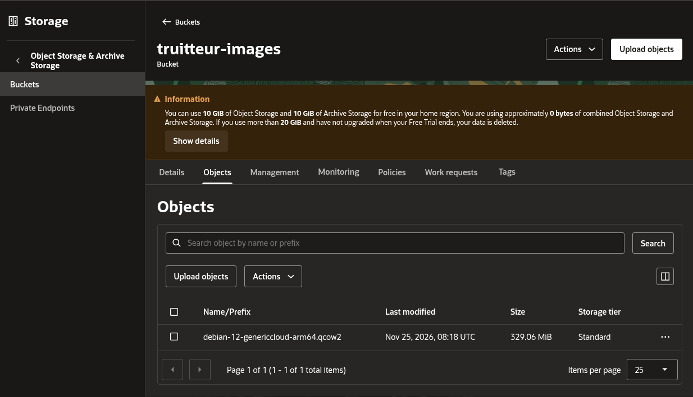
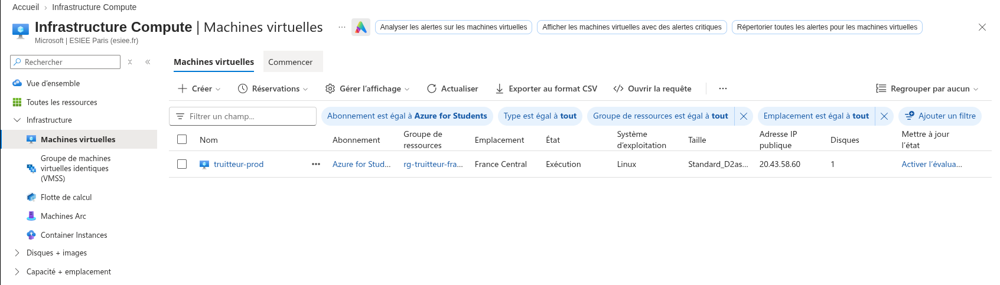
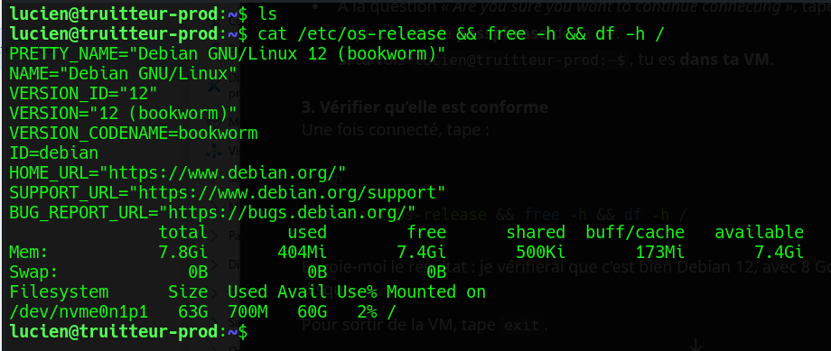
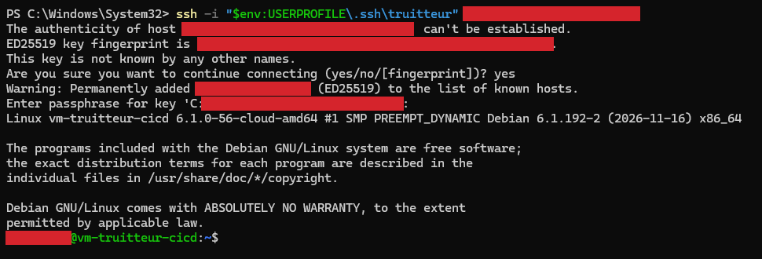
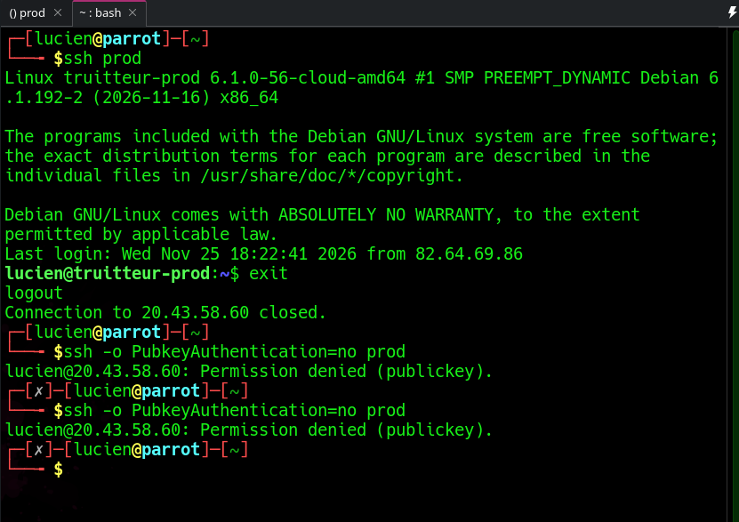
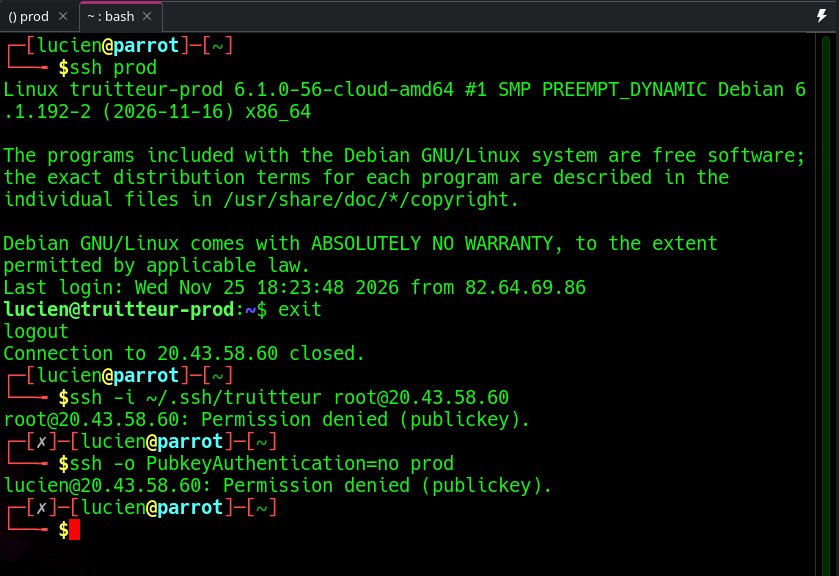
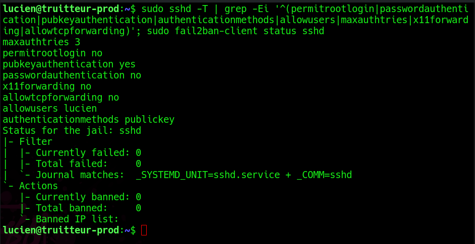
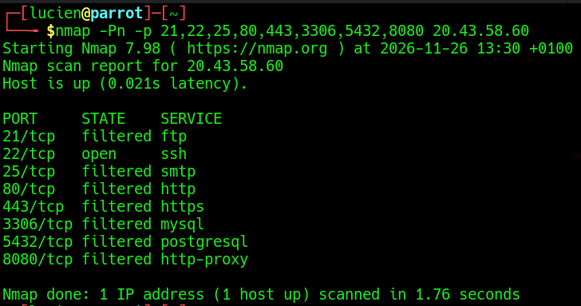

# DevSecOps – Truitteur

Projet de l'unité CYB_4201A (ESIEE Paris) : sécuriser toute la chaîne de développement de **Truitteur**, une application Java 17 / Spring Boot à exposer sur le web.

Ce README sert de **journal de bord** : chaque étape réalisée y est décrite (ce qu'on a fait, pourquoi, les fichiers modifiés, les problèmes rencontrés). Il sert de base à la rédaction du rapport final (rendu prévu le 21/01, à confirmer).

## Équipe : Les 4 vulnérabilités

| Membre | Rôle principal |
|--------|----------------|
| Lucas (capitaine) | Coordination, rapport, schémas, appui Sec |
| Lucien | Ops – serveurs de production et CI/CD (SSH, iptables, installation des services) ; héberge la VM prod |
| Ayoub | Dev – configuration Jenkins / Nexus / SonarQube et pipeline ; héberge la VM CI/CD |
| Steven | Sec – analyse SonarQube, tests OWASP, rapport de failles |

Tout le monde doit comprendre l'ensemble du projet (QCM final et rapport commun) : chaque étape est expliquée dans le journal ci-dessous.

## Méthode de travail

- Toujours faire `git pull` avant de modifier un fichier, puis un commit par étape avec un message clair.
- Chaque étape terminée est documentée dans le **Journal de bord** : objectif, commandes, fichiers modifiés, problèmes rencontrés, captures.
- Les fichiers de configuration finaux sont rangés dans `prod/`, `cicd/` ou `pipeline/` : ils permettent de réinstaller un serveur rapidement si quelque chose casse.
- Sauvegardes : ce dépôt (configs et scripts de réinstallation) et une copie locale ; snapshots des disques Azure aux étapes majeures si les crédits le permettent.
- Les VM Azure sont **éteintes après chaque séance** pour économiser les crédits.

## Architecture

| VM | Rôle | Services |
|----|------|----------|
| `prod` | Production | SSH, iptables, JRE 17, PostgreSQL 15, nginx (reverse proxy), service systemd |
| `cicd` | Intégration / livraison continue | SSH, iptables, Jenkins, SonarQube, Nexus 3, Maven, JDK 17, git, nginx (reverse proxy) |

Hébergement : Azure for Students (une VM par compte étudiant), Debian 12 x86_64. Détails et justification : voir l'étape 0.

_Schéma d'architecture à ajouter._

## Organisation du dépôt

| Dossier | Contenu |
|---------|---------|
| `prod/` | Fichiers de configuration du serveur de production (sshd, iptables, nginx, systemd…) |
| `cicd/` | Fichiers de configuration du serveur CI/CD (Jenkins, SonarQube, Nexus, nginx…) |
| `pipeline/` | Jenkinsfile et scripts de déploiement |
| `sec/` | Rapports d'analyse, liste et priorisation des failles |
| `captures/` | Captures d'écran pour le rapport (nommées `NN-etape-description.png`) |

⚠️ Aucun secret (clé privée, mot de passe, token) ne doit être commité.

## Tableau d'avancement

| Étape | Statut | Responsable |
|-------|--------|-------------|
| SSH | Validé (prod) | Lucien |
| Iptables | Validé (prod) | Lucien |
| Prod | À faire | Lucien |
| Serveur CI/CD | Commencé (VM créée) | Ayoub |
| Jenkins | À faire | Ayoub |
| Sonar | À faire | Ayoub |
| Nexus | À faire | Ayoub |
| Pipeline | À faire | Ayoub |
| Analyse | À faire | Steven / Lucas |
| Déploiement | À faire | Tous |

Statuts possibles : À faire · Commencé · En cours · À faire vérifier · Validé · Terminé

## Journal de bord

### Étape 0 – Choix de l'hébergement et du système

**Statut : VM de production créée (Azure, France Central). VM CI/CD créée et connexion SSH testée.**

#### Ce dont on a besoin
Deux serveurs Linux sans interface graphique, accessibles depuis Internet :

| VM | Rôle | Taille visée | Hébergée sur le compte de |
|----|------|--------------|---------------------------|
| `truitteur-prod` | Production | 2 vCPU, 8 Go de RAM (Standard_D2as_v7, Spot), disque 64 Go SSD Standard | Lucien |
| `truitteur-cicd` | CI/CD (Jenkins, SonarQube, Nexus) | 2 vCPU, 16 Go de RAM (Standard_E2as_v7, Spot), disque 64 Go | Ayoub |

La VM CI/CD a besoin de plus de mémoire : SonarQube et Nexus consomment chacun 2 à 4 Go.

#### Première tentative : Oracle Cloud (abandonnée)
Oracle Cloud Infrastructure (OCI) est le cloud public d'Oracle, en mode *IaaS* (on loue des VM, du stockage et du réseau, et on gère nous-mêmes le système). Son offre *Always Free* était la plus généreuse : 4 cœurs ARM, 24 Go de RAM et 200 Go de disque gratuits sans limite de durée [1].

Ce que nous avons fait :
1. Création du compte (région France Central – Paris), possible sans carte bancaire grâce à l'adresse e-mail de l'école ;
2. Import de l'image officielle Debian 12 *genericcloud arm64* (Debian n'est pas dans les images de base d'Oracle) : dépôt dans un *bucket* Object Storage, puis import en image personnalisée, en passant le firmware en **UEFI_64** (obligatoire pour les processeurs ARM) ;
3. Création du réseau avec l'assistant VCN (*VCN with Internet Connectivity*) : le formulaire de création de VM ne permettait pas d'attribuer une IP publique sur un subnet créé à la volée ;
4. Création de la VM : **échec « Out of capacity »**. La région Paris (un seul *availability domain*) n'avait plus de processeurs ARM gratuits disponibles.





Pour débloquer la situation, Oracle propose de passer le compte en *Pay As You Go* (comptes prioritaires sur la capacité). Nous l'avons écarté : cela demande une carte bancaire avec une pré-autorisation de 100 $ [4], et Oracle ne permet pas de plafonner les dépenses (les budgets envoient seulement des alertes). Le compte Oracle est conservé, il ne coûte rien.

#### Choix retenu : Azure for Students
| Plateforme | Offre | Limites pour notre projet |
|------------|-------|---------------------------|
| **Azure for Students** | 100 $ de crédits par étudiant sur 12 mois, **sans carte bancaire** [3] | Crédits limités : il faut éteindre les VM quand on ne travaille pas |
| Oracle Cloud (Always Free) | 4 OCPU ARM + 24 Go + 200 Go, gratuit sans limite de durée [1] | Pas de capacité disponible à Paris ; déblocage payant |
| AWS / Google Cloud | Petites VM gratuites (≈1 Go de RAM) | Insuffisant, carte bancaire obligatoire |
| DigitalOcean (GitHub Student Pack) | Offre étudiante arrêtée en juillet 2026 | Plus disponible |

Pourquoi Azure for Students :
- **Aucun risque de facturation** : sans carte bancaire, l'abonnement est simplement désactivé quand les crédits sont épuisés [3] ;
- **Disponible immédiatement**, sans problème de capacité ;
- **Processeurs x86** : aucun doute de compatibilité pour SonarQube et Nexus ;
- **Une VM par compte** : la prod est sur le compte de Lucien et la CI/CD sur celui d'Ayoub, soit 200 $ de crédits au total (Steven et Lucas gardent leurs 100 $ en réserve).

Gestion des crédits (≈0,094 $/h pour une B2ms et ≈0,19 $/h pour une B4ms à France Central [5]) :
- les VM sont **arrêtées (désallouées) quand on ne travaille pas** : le calcul n'est alors plus facturé, seul le disque l'est ;
- un **arrêt automatique** est programmé chaque soir ;
- estimation pour ~100 h d'utilisation : ≈10 $ (prod) et ≈20 $ (CI/CD), disques compris.

#### Les contraintes des abonnements Azure for Students
La création de la VM a demandé plusieurs essais. Nous avons analysé l'abonnement avec Azure Cloud Shell (Azure CLI) :

1. **Régions autorisées** : une stratégie Azure (*Allowed resource deployment regions*) limite les déploiements à 5 régions : Austria East, Denmark East, Norway East, France Central et Germany West Central ;
2. **Quota global** : 6 cœurs par région (`cores`), plus 3 cœurs pour les VM Spot (`lowPriorityCores`) ;
3. **Blocage croisé** :
   - les familles qui ont un quota (B, Bsv2, Dv3, Dv4, Ev3…) sont marquées `NotAvailableForSubscription` dans toutes les régions autorisées ;
   - les familles réellement disponibles (dernière génération **v7**) ont un quota standard de **0**.

Impossible donc de créer une VM « classique ». La solution retenue est une **VM Spot** : elle utilise la capacité inutilisée d'Azure, à prix fortement réduit, et consomme le quota Spot (3 cœurs) au lieu du quota de la famille.

| Paramètre | Valeur |
|-----------|--------|
| Taille | `Standard_D2as_v7` (2 vCPU AMD, 8 Go) |
| Région | France Central |
| Image | Debian 12 Gen2 (`Debian:debian-12:12-gen2:latest`) |
| Disque | 64 Go, SSD Standard |
| Priorité | Spot, prix max = prix normal (`--max-price -1`), éviction = *Deallocate* |
| Accès | Clé SSH uniquement (utilisateur `lucien`), port 22 ouvert dans le NSG |
| Arrêt automatique | 23h (heure de Paris), notification par e-mail |

Conséquence à connaître : Azure peut **reprendre une VM Spot** s'il a besoin de la capacité. Avec la politique *Deallocate*, la VM est seulement arrêtée et son disque est conservé : il suffit de la redémarrer. Pour un projet de cours, ce risque est acceptable.

Vérification après création (connexion SSH avec la clé, puis `cat /etc/os-release && free -h && df -h /`) : Debian 12 (bookworm), 7,8 Gio de RAM, disque NVMe de 63 Go.




Le script [`prod/creer-vm-azure.sh`](prod/creer-vm-azure.sh) permet de recréer la VM à l'identique.

#### Création de la VM CI/CD

J’ai créé la VM CI/CD sur Azure for Students, en France Central. Elle tourne sous Debian 12 sur une instance Spot avec 2 vCPU, 16 Gio de RAM et un SSD de 64 Gio.

J’ai configuré l’accès par clé SSH et limité le port 22 à mon adresse IP dans Azure. J’ai testé la connexion depuis PowerShell et j’ai pu ouvrir un terminal sur la VM. Après le test, j’ai arrêté la VM depuis Azure pour économiser les crédits.



La prochaine étape sera de vérifier les réglages SSH sur Debian, puis de configurer iptables.

#### Pourquoi Debian 12 ?
- **Les versions demandées par le sujet sont dans les dépôts officiels** : Debian 12 fournit directement OpenJDK 17 et PostgreSQL 15. Debian 13 fournit des versions plus récentes (Java 21, PostgreSQL 17) et nous obligerait à ajouter des dépôts tiers, ce qui élargit la chaîne de confiance ;
- **Toujours maintenue** : le support standard de Debian 12 s'est terminé en juillet 2026, mais elle reçoit les correctifs de sécurité de l'équipe LTS jusqu'au 30 juin 2028 [2]. Cela couvre largement la durée du projet ;
- **Distribution stable et répandue** sur les serveurs, publiée officiellement par Debian sur Azure.

#### Pourquoi sans interface graphique ?
- **Surface d'attaque réduite** : moins de paquets installés, donc moins de failles potentielles et moins de mises à jour ;
- **Moins de ressources consommées**, laissées aux services du projet ;
- **Administration uniquement par SSH**, ce qui est la norme pour un serveur et permet de tout scripter (réinstallation rapide).

### Étape 1 – Sécurisation de l'accès SSH (serveur de production)

**Statut : validé sur `truitteur-prod`.**

#### Objectif
Le sujet demande « une connexion SSH configurée de manière sécurisée (pas d'accès au compte root, interdiction d'utiliser un mot de passe, connexion par clé SSH…) ». SSH est la seule porte d'administration du serveur : c'est la première chose qu'un attaquant essaie de forcer (bruteforce de mots de passe, connexion en root).

#### Ce que nous avons mis en place
| Mesure | Pourquoi |
|--------|----------|
| Clé SSH **ed25519 protégée par passphrase** | Algorithme moderne. La clé seule ne suffit pas : en cas de vol du fichier, il faut aussi la passphrase |
| `PermitRootLogin no` | root existe sur toutes les machines : c'est le premier compte visé. On se connecte avec un utilisateur nominatif puis `sudo` (traçabilité) |
| `PasswordAuthentication no`, `KbdInteractiveAuthentication no`, `AuthenticationMethods publickey` | Rend le bruteforce de mots de passe impossible |
| `AllowUsers lucien` | Liste blanche des comptes autorisés (le compte de déploiement sera ajouté plus tard) |
| `MaxAuthTries 3`, `LoginGraceTime 30`, `MaxStartups 10:30:60` | Limite les tentatives et les connexions non authentifiées simultanées |
| `X11Forwarding`, `AllowAgentForwarding`, `AllowTcpForwarding`, `PermitTunnel` à `no` | Fonctions inutiles sur un serveur : elles pourraient servir de rebond à un attaquant |
| `ClientAliveInterval 300` + `ClientAliveCountMax 2` | Coupe les sessions abandonnées après 10 minutes |
| **fail2ban** (jail `sshd`) | Bannit pendant 1 h une IP qui échoue 5 fois en 10 min |
| **unattended-upgrades** | Installe automatiquement les correctifs de sécurité Debian chaque jour |

Nous n'avons pas modifié `/etc/ssh/sshd_config` : la configuration est dans un fichier séparé, `/etc/ssh/sshd_config.d/00-hardening.conf`. Avec OpenSSH, la **première** valeur lue l'emporte, et le préfixe `00-` garantit que nos réglages passent avant ceux d'Azure/cloud-init (`50-cloud-init.conf`).

Sur Debian 12, les journaux d'authentification ne sont plus dans `/var/log/auth.log` mais dans *journald* : fail2ban doit donc utiliser `backend = systemd` (et le paquet `python3-systemd`).

#### Fichiers
- [`prod/ssh/00-hardening.conf`](prod/ssh/00-hardening.conf) → `/etc/ssh/sshd_config.d/00-hardening.conf`
- [`prod/fail2ban/jail.local`](prod/fail2ban/jail.local) → `/etc/fail2ban/jail.local`
- [`prod/apt/20auto-upgrades`](prod/apt/20auto-upgrades) → `/etc/apt/apt.conf.d/20auto-upgrades`
- [`prod/setup-prod.sh`](prod/setup-prod.sh) : réapplique toute l'étape sur une VM neuve

#### Méthode et précautions
1. Vérification de la syntaxe avant application : `sudo sshd -t && sudo systemctl reload ssh` (`reload` ne coupe pas les sessions ouvertes) ;
2. Une **session SSH gardée ouverte** pendant les tests, pour ne pas perdre l'accès en cas d'erreur ;
3. Raccourci côté poste client dans `~/.ssh/config` (`Host prod`) : la connexion se fait avec `ssh prod`.

#### Tests de validation
| Test (depuis le poste client) | Résultat attendu | Résultat |
|-------------------------------|------------------|----------|
| `ssh prod` (clé + passphrase) | Connexion | ✅ Connexion |
| `ssh -o PubkeyAuthentication=no prod` (mot de passe) | Refus | ✅ `Permission denied (publickey)` |
| `ssh -i ~/.ssh/truitteur root@<IP>` | Refus | ✅ `Permission denied (publickey)` |
| `sudo fail2ban-client status sshd` | Jail active | ✅ Jail `sshd` active, filtre journald |
| `sudo unattended-upgrades --dry-run --debug` | Pas d'erreur | ✅ Exécution sans erreur, aucun paquet en attente |




Configuration **effectivement appliquée** par le serveur (`sshd -T` affiche la configuration finale après lecture de tous les fichiers) et état de fail2ban :



<details>
<summary>Sortie de l'installation de fail2ban et unattended-upgrades</summary>

```
lucien@truitteur-prod:~$ sudo systemctl enable --now fail2ban
Synchronizing state of fail2ban.service with SysV service script with /lib/systemd/systemd-sysv-install.
Executing: /lib/systemd/systemd-sysv-install enable fail2ban
lucien@truitteur-prod:~$ sudo systemctl restart fail2ban
lucien@truitteur-prod:~$ sudo fail2ban-client status sshd
Status for the jail: sshd
|- Filter
|  |- Currently failed: 0
|  |- Total failed:     0
|  `- Journal matches:  _SYSTEMD_UNIT=sshd.service + _COMM=sshd
`- Actions
   |- Currently banned: 0
   |- Total banned:     0
   `- Banned IP list:
lucien@truitteur-prod:~$ sudo apt install -y unattended-upgrades apt-listchanges
unattended-upgrades is already the newest version (2.9.1+nmu3).
apt-listchanges is already the newest version (3.24).
lucien@truitteur-prod:~$ sudo unattended-upgrades --dry-run --debug 2>&1 | tail -5
fetch.run() result: 0
Packages blacklist due to conffile prompts: []
No packages found that can be upgraded unattended and no pending auto-removals
The list of kept packages can't be calculated in dry-run mode.
```
</details>

#### Problème rencontré
Des avertissements `perl: warning: Setting locale failed` apparaissent lors des commandes `apt`/`systemctl`. Cause : le client SSH transmet ses variables de langue (`LC_TIME=fr_FR.UTF-8`…) alors que la locale française n'est pas installée sur le serveur. Sans conséquence ; correction possible en générant la locale `fr_FR.UTF-8` sur le serveur.

### Étape 2 – Pare-feu iptables (serveur de production)

**Statut : validé sur `truitteur-prod`.**

#### Objectif
Le sujet demande « un pare-feu iptables le moins permissif possible (tout en DROP et on n'autorise en entrée et sortie que ce dont on a besoin) ». Filtrer aussi la **sortie** limite ce qu'un attaquant peut faire s'il compromet l'application : impossible d'ouvrir un *reverse shell* vers un port arbitraire, d'exfiltrer des données en SSH ou de rebondir vers d'autres machines.

#### Politique retenue
| Sens | Autorisé | Justification |
|------|----------|---------------|
| Entrée | TCP 22 (SSH) | Administration ; déjà protégé par clé SSH + fail2ban |
| Entrée | TCP 80 et 443 | Exposition de l'application via nginx (étape suivante) |
| Sortie | TCP 80 et 443 | Mises à jour `apt` (les miroirs Debian n'ont pas d'IP fixe) |
| Sortie | DNS (UDP/TCP 53) **uniquement vers 168.63.129.16** | Le résolveur DNS d'Azure : aucun autre serveur DNS n'est joignable (limite l'exfiltration par DNS) |
| Sortie | UDP 123 | Synchronisation de l'heure (NTP) |
| Sortie | ICMP *echo-request* | Ping de diagnostic (le ping **entrant** reste bloqué) |
| Entrée/Sortie | DHCP (UDP 67/68), WireServer `168.63.129.16` (TCP 80, 32526), IMDS `169.254.169.254` (TCP 80) | **Services internes Azure** : sans eux, la VM ne renouvelle plus son adresse réseau et l'agent Azure ne fonctionne plus |
| Entrée/Sortie | Interface `lo` | Communication locale : application ↔ PostgreSQL, nginx ↔ application |
| Entrée/Sortie | État `ESTABLISHED,RELATED` | Réponses aux connexions autorisées (pare-feu à états, module `conntrack`) |
| Entrée | État `INVALID` → DROP | Paquets incohérents (scans, paquets forgés) |
| — | Tout le reste | **Journalisé** (5/min max, préfixes `IPT-DROP-IN` / `IPT-DROP-OUT`) puis **refusé** |

IPv6 n'étant pas utilisé, sa politique est également DROP (seule la boucle locale est autorisée).

Le piège des VM cloud : un pare-feu « tout en DROP » écrit pour un serveur physique bloque les services internes du fournisseur (DHCP, agent, DNS, métadonnées). La VM fonctionne quelques heures puis perd son réseau au renouvellement du bail DHCP. Nous avons donc identifié et autorisé explicitement ces services Azure.

#### Défense en profondeur
Deux pare-feu se superposent :
1. le **NSG Azure** (Network Security Group), devant la VM : pour l'instant, seul le port 22 y est ouvert ;
2. **iptables** sur la VM, qui filtre aussi les flux sortants (le NSG ne s'en occupe pas par défaut).

Si l'un est mal configuré, l'autre protège encore la machine.

#### Méthode et précautions
- Outils installés **avant** de bloquer la sortie (`iptables-persistent` pour recharger les règles au démarrage) ;
- Règles écrites dans un fichier (`/etc/iptables/rules.v4`), chargées d'un bloc avec `iptables-restore` ;
- Application avec **`iptables-apply -t 120`** : les règles sont annulées automatiquement si l'administrateur ne confirme pas sous 120 s qu'une **nouvelle** connexion SSH fonctionne. Cela évite de perdre l'accès à la VM en cas d'erreur ;
- Redémarrage de fail2ban après le chargement, pour qu'il réinsère ses propres règles de bannissement.

#### Fichiers
- [`prod/iptables/rules.v4`](prod/iptables/rules.v4) → `/etc/iptables/rules.v4`
- [`prod/iptables/rules.v6`](prod/iptables/rules.v6) → `/etc/iptables/rules.v6`
- [`prod/setup-prod.sh`](prod/setup-prod.sh) : étape ajoutée au script de réinstallation

#### Tests de validation
| Test | Résultat attendu | Résultat |
|------|------------------|----------|
| Nouvelle connexion `ssh prod` pendant `iptables-apply` | Connexion | ✅ |
| `sudo apt update` (DNS Azure + HTTPS sortant) | Fonctionne | ✅ `All packages are up to date.` |
| `ping -c 2 1.1.1.1` | Répond | ✅ 0 % de perte |
| Connexion sortante vers `1.1.1.1:22` | Bloquée | ✅ `SORTIE 22 BLOQUEE` |
| Journaux noyau `IPT-DROP` | Paquets refusés tracés | ✅ (voir ci-dessous) |
| Redémarrage de la VM (`sudo reboot`) | Règles rechargées automatiquement | ✅ `policy DROP`, `netfilter-persistent` et `fail2ban` actifs |
| `nmap` depuis l'extérieur | Seul le 22 ouvert | ✅ 22 `open`, tout le reste `filtered` |

Les ports 80 et 443 apparaissent `filtered` dans nmap : ils sont autorisés par iptables, mais encore fermés dans le NSG Azure et aucun service n'écoute derrière. Ils seront ouverts à l'étape nginx.



<details>
<summary>Règles chargées (<code>iptables -L -n -v</code>) et sorties des tests</summary>

```
lucien@truitteur-prod:~$ sudo iptables -L -n -v --line-numbers | head -40
Chain INPUT (policy DROP 0 packets, 0 bytes)
num   pkts bytes target     prot opt in     out     source               destination
1        0     0 ACCEPT     0    --  lo     *       0.0.0.0/0            0.0.0.0/0
2      138 23308 ACCEPT     0    --  *      *       0.0.0.0/0            0.0.0.0/0            ctstate RELATED,ESTABLISHED
3        0     0 DROP       0    --  *      *       0.0.0.0/0            0.0.0.0/0            ctstate INVALID
4        0     0 ACCEPT     17   --  *      *       0.0.0.0/0            0.0.0.0/0            udp spt:67 dpt:68
5        0     0 ACCEPT     6    --  *      *       0.0.0.0/0            0.0.0.0/0            tcp dpt:22 ctstate NEW
6        0     0 ACCEPT     6    --  *      *       0.0.0.0/0            0.0.0.0/0            multiport dports 80,443 ctstate NEW
7        0     0 LOG_DROP_IN  0    --  *      *       0.0.0.0/0            0.0.0.0/0

Chain FORWARD (policy DROP 0 packets, 0 bytes)
num   pkts bytes target     prot opt in     out     source               destination

Chain OUTPUT (policy DROP 0 packets, 0 bytes)
num   pkts bytes target     prot opt in     out     source               destination
1        0     0 ACCEPT     0    --  *      lo      0.0.0.0/0            0.0.0.0/0
2      124 26929 ACCEPT     0    --  *      *       0.0.0.0/0            0.0.0.0/0            ctstate RELATED,ESTABLISHED
3        0     0 ACCEPT     17   --  *      *       0.0.0.0/0            0.0.0.0/0            udp spt:68 dpt:67
4       21  1260 ACCEPT     6    --  *      *       0.0.0.0/0            168.63.129.16        multiport dports 80,32526
5        0     0 ACCEPT     17   --  *      *       0.0.0.0/0            168.63.129.16        udp dpt:53
6        0     0 ACCEPT     6    --  *      *       0.0.0.0/0            168.63.129.16        tcp dpt:53
7        1    60 ACCEPT     6    --  *      *       0.0.0.0/0            169.254.169.254      tcp dpt:80
8        0     0 ACCEPT     6    --  *      *       0.0.0.0/0            0.0.0.0/0            multiport dports 80,443 ctstate NEW
9        0     0 ACCEPT     17   --  *      *       0.0.0.0/0            0.0.0.0/0            udp dpt:123
10       0     0 ACCEPT     1    --  *      *       0.0.0.0/0            0.0.0.0/0            icmptype 8
11       0     0 LOG_DROP_OUT  0    --  *      *       0.0.0.0/0            0.0.0.0/0

Chain LOG_DROP_IN (1 references)
num   pkts bytes target     prot opt in     out     source               destination
1        0     0 LOG        0    --  *      *       0.0.0.0/0            0.0.0.0/0            limit: avg 5/min burst 5 LOG flags 0 level 4 prefix "IPT-DROP-IN: "
2        0     0 DROP       0    --  *      *       0.0.0.0/0            0.0.0.0/0

Chain LOG_DROP_OUT (1 references)
num   pkts bytes target     prot opt in     out     source               destination
1        0     0 LOG        0    --  *      *       0.0.0.0/0            0.0.0.0/0            limit: avg 5/min burst 5 LOG flags 0 level 4 prefix "IPT-DROP-OUT: "
2        0     0 DROP       0    --  *      *       0.0.0.0/0            0.0.0.0/0

lucien@truitteur-prod:~$ sudo apt update 2>&1 | tail -2
Reading state information...
All packages are up to date.

lucien@truitteur-prod:~$ ping -c 2 1.1.1.1
64 bytes from 1.1.1.1: icmp_seq=1 ttl=54 time=3.85 ms
64 bytes from 1.1.1.1: icmp_seq=2 ttl=54 time=2.55 ms
2 packets transmitted, 2 received, 0% packet loss, time 1002ms

lucien@truitteur-prod:~$ timeout 5 bash -c 'echo > /dev/tcp/1.1.1.1/22' && echo "SORTIE 22 OUVERTE (anormal)" || echo "SORTIE 22 BLOQUEE (normal)"
SORTIE 22 BLOQUEE (normal)

lucien@truitteur-prod:~$ sudo journalctl -k --since "5 min ago" | grep IPT-DROP | tail -3
nov. 26 12:30:20 truitteur-prod kernel: IPT-DROP-OUT: IN= OUT=eth0 SRC=10.0.0.4 DST=1.1.1.1 LEN=60 ... PROTO=TCP SPT=47332 DPT=22 ... SYN
nov. 26 12:30:21 truitteur-prod kernel: IPT-DROP-OUT: IN= OUT=eth0 SRC=10.0.0.4 DST=1.1.1.1 LEN=60 ... PROTO=TCP SPT=47332 DPT=22 ... SYN
nov. 26 12:30:23 truitteur-prod kernel: IPT-DROP-OUT: IN= OUT=eth0 SRC=10.0.0.4 DST=1.1.1.1 LEN=60 ... PROTO=TCP SPT=47332 DPT=22 ... SYN
```
</details>

#### À compléter plus tard
- Étape livraison : autoriser la VM CI/CD (son IP uniquement) à se connecter au compte de déploiement ;
- Étape nginx : ouvrir 80/443 dans le NSG Azure ;
- PostgreSQL n'écoutera que sur `127.0.0.1` : le port 5432 n'est **pas** ouvert dans iptables.

#### Problème rencontré
Les avertissements `perl: warning: Setting locale failed` (client SSH qui transmet `LC_*=fr_FR.UTF-8`) ont été supprimés en installant le paquet `locales` et en générant la locale `fr_FR.UTF-8`.

## Sources

[1] Oracle, « Oracle Cloud Infrastructure Free Tier », *Oracle Cloud Infrastructure Documentation*. [En ligne]. Disponible : https://docs.oracle.com/iaas/Content/FreeTier/freetier.htm

[2] Debian, « Debian "bookworm" Release Information ». [En ligne]. Disponible : https://www.debian.org/releases/bookworm/

[3] Microsoft, « Azure for Students ». [En ligne]. Disponible : https://azure.microsoft.com/en-us/pricing/offers/ms-azr-0170p/

[4] Oracle, « Managing Account Upgrades and Payment Method », *Oracle Cloud Infrastructure Documentation*. [En ligne]. Disponible : https://docs.oracle.com/iaas/Content/Billing/Tasks/changingpaymentmethod.htm

[5] AzureSpeed, « Azure VM pricing in France Central ». [En ligne]. Disponible : https://www.azurespeed.com/AzureVmPricing/Regions/francecentral
