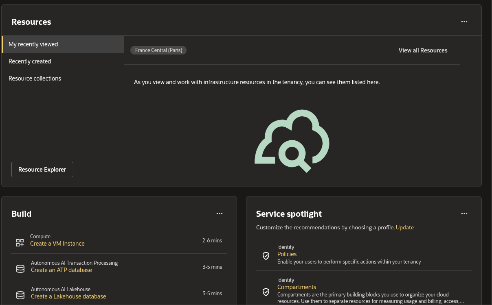
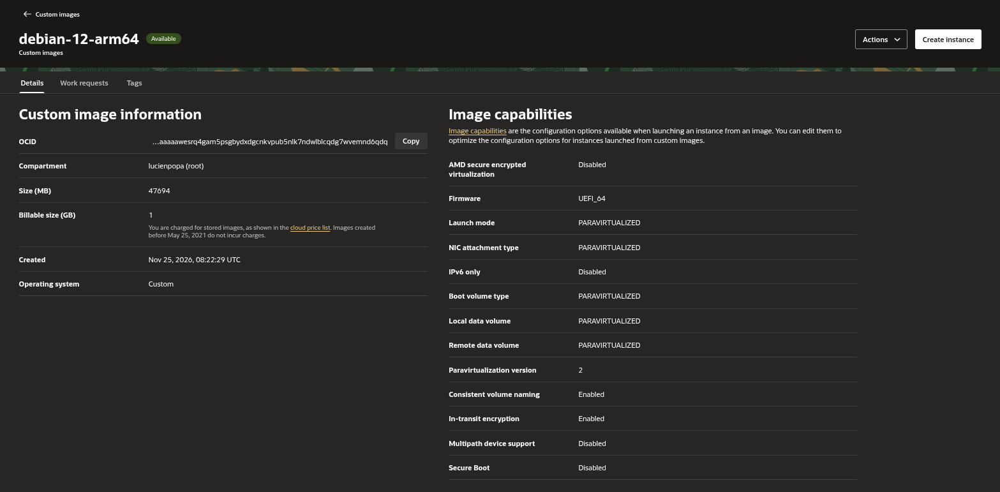
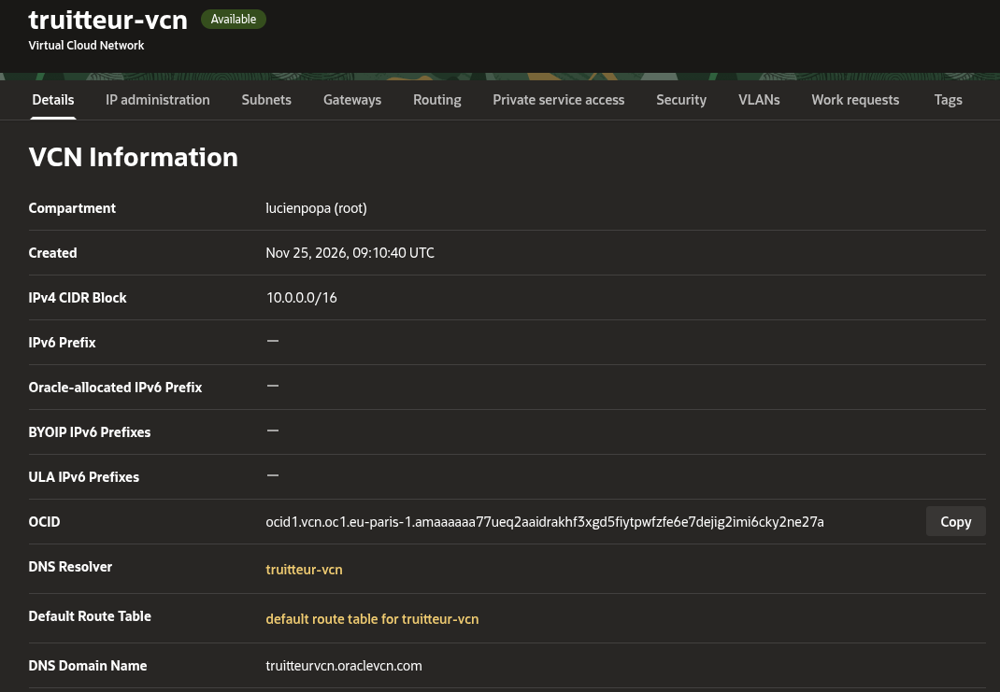
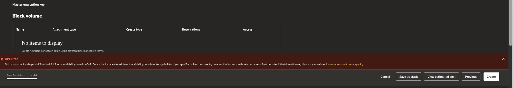

# DevSecOps – Truitteur

Projet de l'unité CYB_4201A (ESIEE Paris) : sécuriser toute la chaîne de développement de **Truitteur**, une application Java 17 / Spring Boot à exposer sur le web.

Ce README sert de **journal de bord** : chaque étape réalisée y est décrite (ce qu'on a fait, pourquoi, les fichiers modifiés, les problèmes rencontrés). Il sert de base à la rédaction du rapport final (rendu prévu le 21/01, à confirmer).

## Équipe : Les 4 vulnérabilités

| Membre | Rôle principal |
|--------|----------------|
| Lucas (capitaine) | Coordination, rapport, schémas, appui Sec |
| Lucien | Ops – serveurs de production et CI/CD (SSH, iptables, installation des services) ; héberge la VM prod |
| Ayoub | Dev – configuration Jenkins / Nexus / SonarQube et pipeline ; héberge la VM CI/CD |
| Steven | Sec – analyse SonarQube, tests OWASP, rapport de failles |

Tout le monde doit comprendre l'ensemble du projet (QCM final et rapport commun) : chaque étape est expliquée dans le journal ci-dessous.

## Méthode de travail

- Toujours faire `git pull` avant de modifier un fichier, puis un commit par étape avec un message clair.
- Chaque étape terminée est documentée dans le **Journal de bord** : objectif, commandes, fichiers modifiés, problèmes rencontrés, captures.
- Les fichiers de configuration finaux sont rangés dans `prod/`, `cicd/` ou `pipeline/` : ils permettent de réinstaller un serveur rapidement si quelque chose casse.
- Sauvegardes : ce dépôt (configs et scripts de réinstallation) et une copie locale ; snapshots des disques Azure aux étapes majeures si les crédits le permettent.
- Les VM Azure sont **éteintes après chaque séance** pour économiser les crédits.

## Architecture

| VM | Rôle | Services |
|----|------|----------|
| `prod` | Production | SSH, iptables, JRE 17, PostgreSQL 15, nginx (reverse proxy), service systemd |
| `cicd` | Intégration / livraison continue | SSH, iptables, Jenkins, SonarQube, Nexus 3, Maven, JDK 17, git, nginx (reverse proxy) |

Hébergement : Azure for Students (une VM par compte étudiant), Debian 12 x86_64. Détails et justification : voir l'étape 0.

_Schéma d'architecture à ajouter._

## Organisation du dépôt

| Dossier | Contenu |
|---------|---------|
| `prod/` | Fichiers de configuration du serveur de production (sshd, iptables, nginx, systemd…) |
| `cicd/` | Fichiers de configuration du serveur CI/CD (Jenkins, SonarQube, Nexus, nginx…) |
| `pipeline/` | Jenkinsfile et scripts de déploiement |
| `sec/` | Rapports d'analyse, liste et priorisation des failles |
| `captures/` | Captures d'écran pour le rapport (nommées `NN-etape-description.png`) |

⚠️ Aucun secret (clé privée, mot de passe, token) ne doit être commité.

## Tableau d'avancement

| Étape | Statut | Responsable |
|-------|--------|-------------|
| SSH | À faire | Lucien |
| Iptables | À faire | Lucien |
| Prod | À faire | Lucien |
| Serveur CI/CD | À faire | Lucien / Ayoub |
| Jenkins | À faire | Ayoub |
| Sonar | À faire | Ayoub |
| Nexus | À faire | Ayoub |
| Pipeline | À faire | Ayoub |
| Analyse | À faire | Steven / Lucas |
| Déploiement | À faire | Tous |

Statuts possibles : À faire · Commencé · En cours · À faire vérifier · Validé · Terminé

## Journal de bord

### Étape 0 – Choix de l'hébergement et du système

**Statut : VM de production créée (Azure, France Central). VM CI/CD à créer.**

#### Ce dont on a besoin
Deux serveurs Linux sans interface graphique, accessibles depuis Internet :

| VM | Rôle | Taille visée | Hébergée sur le compte de |
|----|------|--------------|---------------------------|
| `truitteur-prod` | Production | 2 vCPU, 8 Go de RAM (Standard_D2as_v7, Spot), disque 64 Go SSD Standard | Lucien |
| `truitteur-cicd` | CI/CD (Jenkins, SonarQube, Nexus) | 2 vCPU, 16 Go de RAM (Standard_E2as_v7, Spot, prévu), disque 64 Go | Ayoub |

La VM CI/CD a besoin de plus de mémoire : SonarQube et Nexus consomment chacun 2 à 4 Go.

#### Première tentative : Oracle Cloud (abandonnée)
Oracle Cloud Infrastructure (OCI) est le cloud public d'Oracle, en mode *IaaS* (on loue des VM, du stockage et du réseau, et on gère nous-mêmes le système). Son offre *Always Free* était la plus généreuse : 4 cœurs ARM, 24 Go de RAM et 200 Go de disque gratuits sans limite de durée [1].

Ce que nous avons fait :
1. Création du compte (région France Central – Paris), possible sans carte bancaire grâce à l'adresse e-mail de l'école ;
2. Import de l'image officielle Debian 12 *genericcloud arm64* (Debian n'est pas dans les images de base d'Oracle) : dépôt dans un *bucket* Object Storage, puis import en image personnalisée, en passant le firmware en **UEFI_64** (obligatoire pour les processeurs ARM) ;
3. Création du réseau avec l'assistant VCN (*VCN with Internet Connectivity*) : le formulaire de création de VM ne permettait pas d'attribuer une IP publique sur un subnet créé à la volée ;
4. Création de la VM : **échec « Out of capacity »**. La région Paris (un seul *availability domain*) n'avait plus de processeurs ARM gratuits disponibles.

Pour débloquer la situation, Oracle propose de passer le compte en *Pay As You Go* (comptes prioritaires sur la capacité). Nous l'avons écarté : cela demande une carte bancaire avec une pré-autorisation de 100 $ [4], et Oracle ne permet pas de plafonner les dépenses (les budgets envoient seulement des alertes). Le compte Oracle est conservé, il ne coûte rien.

#### Choix retenu : Azure for Students
| Plateforme | Offre | Limites pour notre projet |
|------------|-------|---------------------------|
| **Azure for Students** | 100 $ de crédits par étudiant sur 12 mois, **sans carte bancaire** [3] | Crédits limités : il faut éteindre les VM quand on ne travaille pas |
| Oracle Cloud (Always Free) | 4 OCPU ARM + 24 Go + 200 Go, gratuit sans limite de durée [1] | Pas de capacité disponible à Paris ; déblocage payant |
| AWS / Google Cloud | Petites VM gratuites (≈1 Go de RAM) | Insuffisant, carte bancaire obligatoire |
| DigitalOcean (GitHub Student Pack) | Offre étudiante arrêtée en juillet 2026 | Plus disponible |

Pourquoi Azure for Students :
- **Aucun risque de facturation** : sans carte bancaire, l'abonnement est simplement désactivé quand les crédits sont épuisés [3] ;
- **Disponible immédiatement**, sans problème de capacité ;
- **Processeurs x86** : aucun doute de compatibilité pour SonarQube et Nexus ;
- **Une VM par compte** : la prod est sur le compte de Lucien et la CI/CD sur celui d'Ayoub, soit 200 $ de crédits au total (Steven et Lucas gardent leurs 100 $ en réserve).

Gestion des crédits (≈0,094 $/h pour une B2ms et ≈0,19 $/h pour une B4ms à France Central [5]) :
- les VM sont **arrêtées (désallouées) quand on ne travaille pas** : le calcul n'est alors plus facturé, seul le disque l'est ;
- un **arrêt automatique** est programmé chaque soir ;
- estimation pour ~100 h d'utilisation : ≈10 $ (prod) et ≈20 $ (CI/CD), disques compris.

#### Les contraintes des abonnements Azure for Students
La création de la VM a demandé plusieurs essais. Nous avons analysé l'abonnement avec Azure Cloud Shell (Azure CLI) :

1. **Régions autorisées** : une stratégie Azure (*Allowed resource deployment regions*) limite les déploiements à 5 régions : Austria East, Denmark East, Norway East, France Central et Germany West Central ;
2. **Quota global** : 6 cœurs par région (`cores`), plus 3 cœurs pour les VM Spot (`lowPriorityCores`) ;
3. **Blocage croisé** :
   - les familles qui ont un quota (B, Bsv2, Dv3, Dv4, Ev3…) sont marquées `NotAvailableForSubscription` dans toutes les régions autorisées ;
   - les familles réellement disponibles (dernière génération **v7**) ont un quota standard de **0**.

Impossible donc de créer une VM « classique ». La solution retenue est une **VM Spot** : elle utilise la capacité inutilisée d'Azure, à prix fortement réduit, et consomme le quota Spot (3 cœurs) au lieu du quota de la famille.

| Paramètre | Valeur |
|-----------|--------|
| Taille | `Standard_D2as_v7` (2 vCPU AMD, 8 Go) |
| Région | France Central |
| Image | Debian 12 Gen2 (`Debian:debian-12:12-gen2:latest`) |
| Disque | 64 Go, SSD Standard |
| Priorité | Spot, prix max = prix normal (`--max-price -1`), éviction = *Deallocate* |
| Accès | Clé SSH uniquement (utilisateur `lucien`), port 22 ouvert dans le NSG |
| Arrêt automatique | 23h (heure de Paris), notification par e-mail |

Conséquence à connaître : Azure peut **reprendre une VM Spot** s'il a besoin de la capacité. Avec la politique *Deallocate*, la VM est seulement arrêtée et son disque est conservé : il suffit de la redémarrer. Pour un projet de cours, ce risque est acceptable.

Vérification après création (connexion SSH avec la clé, puis `cat /etc/os-release && free -h && df -h /`) : Debian 12 (bookworm), 7,8 Gio de RAM, disque NVMe de 63 Go.

Le script [`prod/creer-vm-azure.sh`](prod/creer-vm-azure.sh) permet de recréer la VM à l'identique.

#### Pourquoi Debian 12 ?
- **Les versions demandées par le sujet sont dans les dépôts officiels** : Debian 12 fournit directement OpenJDK 17 et PostgreSQL 15. Debian 13 fournit des versions plus récentes (Java 21, PostgreSQL 17) et nous obligerait à ajouter des dépôts tiers, ce qui élargit la chaîne de confiance ;
- **Toujours maintenue** : le support standard de Debian 12 s'est terminé en juillet 2026, mais elle reçoit les correctifs de sécurité de l'équipe LTS jusqu'au 30 juin 2028 [2]. Cela couvre largement la durée du projet ;
- **Distribution stable et répandue** sur les serveurs, publiée officiellement par Debian sur Azure.

#### Pourquoi sans interface graphique ?
- **Surface d'attaque réduite** : moins de paquets installés, donc moins de failles potentielles et moins de mises à jour ;
- **Moins de ressources consommées**, laissées aux services du projet ;
- **Administration uniquement par SSH**, ce qui est la norme pour un serveur et permet de tout scripter (réinstallation rapide).

## Sources

[1] Oracle, « Oracle Cloud Infrastructure Free Tier », *Oracle Cloud Infrastructure Documentation*. [En ligne]. Disponible : https://docs.oracle.com/iaas/Content/FreeTier/freetier.htm

[2] Debian, « Debian "bookworm" Release Information ». [En ligne]. Disponible : https://www.debian.org/releases/bookworm/

[3] Microsoft, « Azure for Students ». [En ligne]. Disponible : https://azure.microsoft.com/en-us/pricing/offers/ms-azr-0170p/

[4] Oracle, « Managing Account Upgrades and Payment Method », *Oracle Cloud Infrastructure Documentation*. [En ligne]. Disponible : https://docs.oracle.com/iaas/Content/Billing/Tasks/changingpaymentmethod.htm

[5] AzureSpeed, « Azure VM pricing in France Central ». [En ligne]. Disponible : https://www.azurespeed.com/AzureVmPricing/Regions/francecentral
